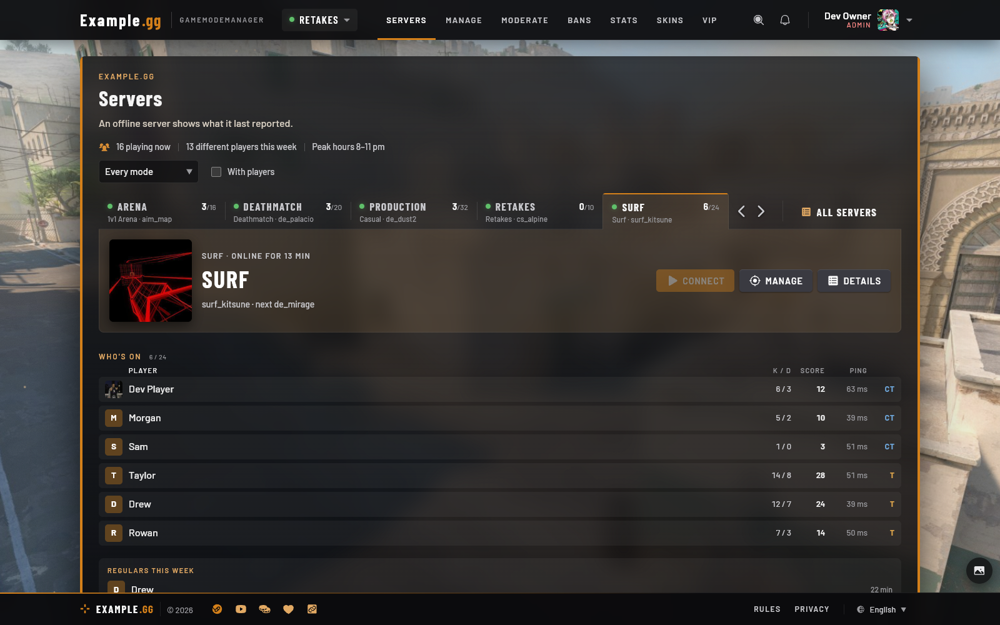
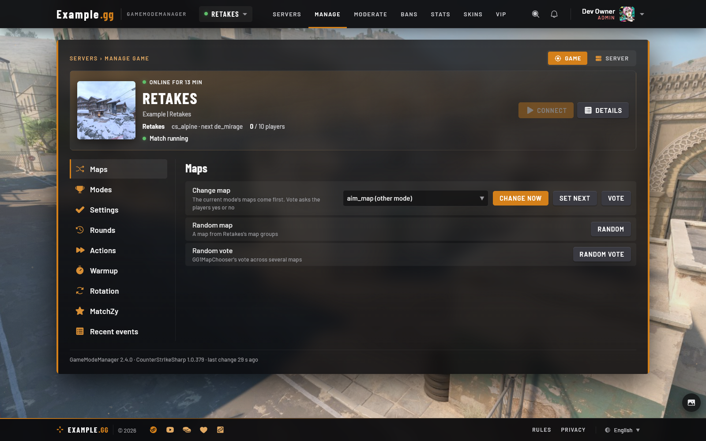
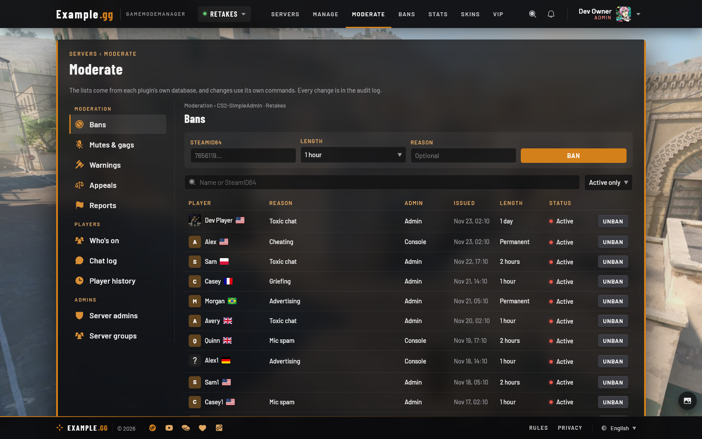
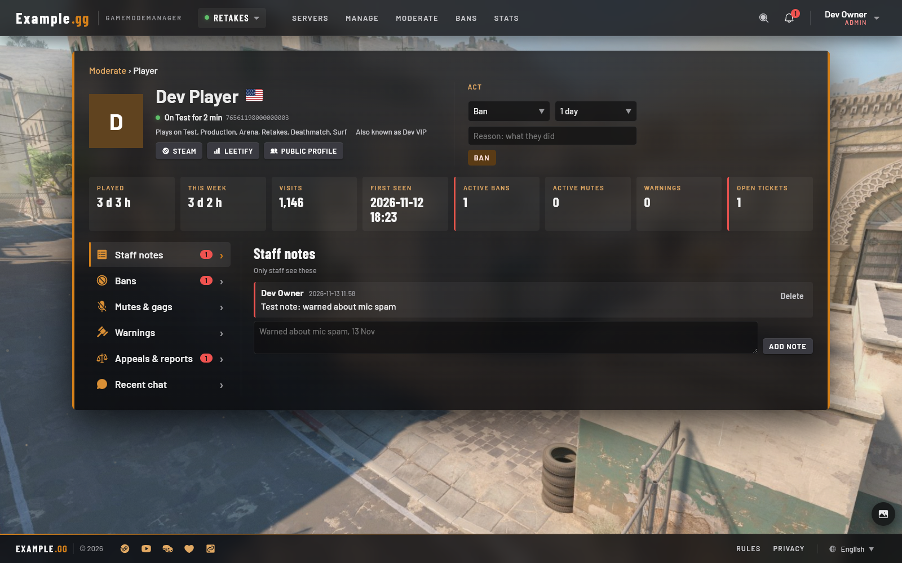
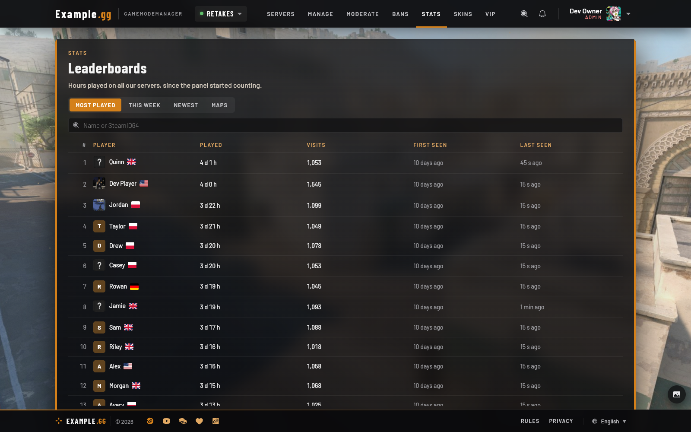
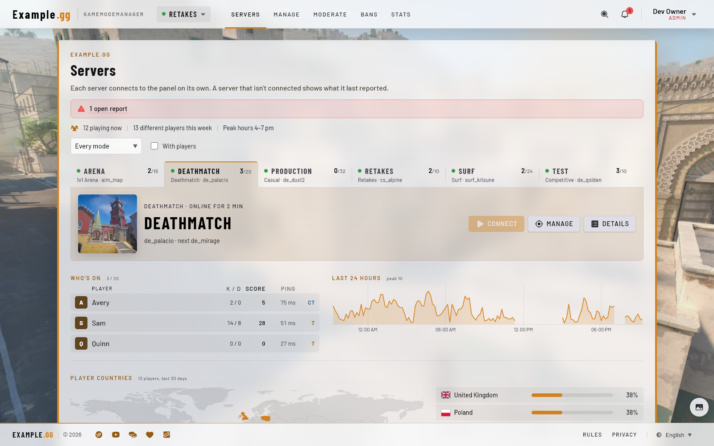
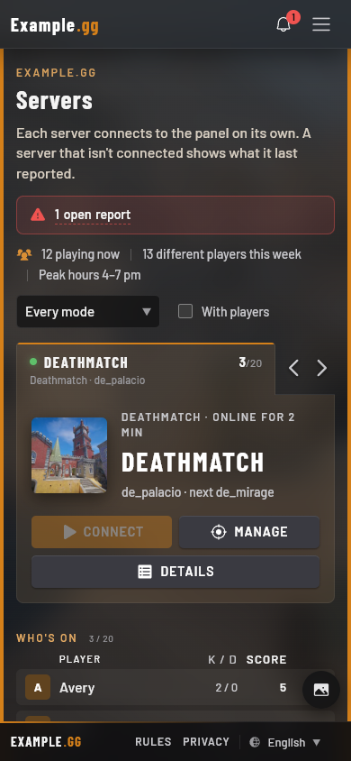
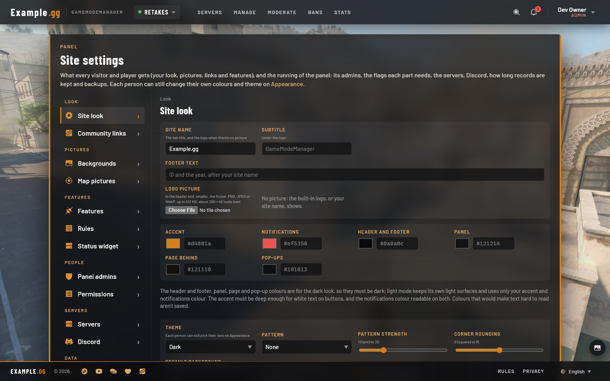

    

# GameModeManager Panel
A web panel for [GameModeManager](https://github.com/nickj609/GameModeManager): your Counter-Strike 2 servers, their players and your community, from any browser.



## Description
Tired of joining the server just to change the map?

The GameModeManager Panel gives your community a home page and your staff the in-game admin menus in a browser:

- **Everything the in-game menus do:** change the map or mode now or next, start votes, turn settings on and off, run actions, pause, replay rounds, warmup and rotation, with the same questions and warnings as in game.
- **A home page for your community:** every server with its map, players and a Connect button, the last 24 hours of players, where your players come from, leaderboards, bans, rules and each player's public profile.
- **Moderation with [CS2-SimpleAdmin](https://github.com/daffyyyy/CS2-SimpleAdmin):** bans, mutes, gags and warnings, the chat log, player history, staff notes, and ban appeals and player reports with replies.
- **Steam sign-in and your own admin flags:** staff get exactly what their flags give them in game, on each server. Panel admins get everything.
- **No open ports and no RCON over the internet:** GameModeManager connects *out* to the panel, so it works on hosts that only give you game ports, and with a Cloudflare Tunnel your home network opens no ports either.
- **Your look:** your name, logo, colours, links and backgrounds, and each person can pick their own theme. Dark and light, desktop and phone, in 13 languages.
- **One small program:** for Windows or a Raspberry Pi, or a Docker image. No database, no Node, and an audit log of everything.

## Enjoying the panel?
Please drop a ⭐ star in the repository

## Pictures
| Manage a server | Moderate |
| :-: | :-: |
|  |  |
| Maps, modes, settings, rounds, actions, warmup, rotation and MatchZy, on the server picked in the header. Admins also get the server's console, hostname and plugins. | CS2-SimpleAdmin's bans, mutes and warnings, who's on, the chat log, player history, and ban appeals and reports. |

| A player | Stats |
| :-: | :-: |
|  |  |
| Everything about one player for staff: their numbers, staff notes, sanctions, appeals and reports, and recent chat, with ban, mute, gag and warn in one place. | Leaderboards for everyone: most played, this week and newest players, with their countries. |

| Light theme | On a phone |
| :-: | :-: |
|  |  |
| Each viewer picks dark or light, their own colours and how see-through the panel is, on **Appearance**. | Every page works on a phone, with the menu in a drawer. |



**Site settings** holds your look, pictures, links, features, panel admins, permissions, servers, Discord, how long records are kept, and backups.

The pictures in this README come from the panel's demo servers, so the players and numbers are made up.

## Requirements
- [GameModeManager](https://github.com/nickj609/GameModeManager) **2.4.0 or newer** on each game server
- A domain for its https address: [Cloudflare](https://www.cloudflare.com/)'s free plan is the easiest, but [any https setup works](https://github.com/nickj609/GameModeManager-WebPanel/wiki/Installation#other-ways-to-host)
- Somewhere that's always on: Windows (x64), a Raspberry Pi 4 or 5 with a 64-bit OS, or a server or Docker host
- Optional: [CS2-SimpleAdmin](https://github.com/daffyyyy/CS2-SimpleAdmin) for bans, mutes and warnings, and [MatchZy](https://github.com/shobhit-pathak/MatchZy) for match controls

# Getting Started
1. In Cloudflare, create a tunnel and give the panel an address on your domain, like `panel.example.com`.
2. Download the panel from [Releases](https://github.com/nickj609/GameModeManager-WebPanel/releases), run it, and open the setup page with the code it prints.
3. Sign in through Steam, add your first server, and paste the settings it gives you into `GameModeManager.json`.

For the full steps, see [Installation](https://github.com/nickj609/GameModeManager-WebPanel/wiki/Installation). For everything else, see [Configuration](https://github.com/nickj609/GameModeManager-WebPanel/wiki/Configuration), [Permissions](https://github.com/nickj609/GameModeManager-WebPanel/wiki/Permissions), [Languages](https://github.com/nickj609/GameModeManager-WebPanel/wiki/Languages) and [Logging](https://github.com/nickj609/GameModeManager-WebPanel/wiki/Logging).

## Credits
The panel is built with [ASP.NET Core](https://dotnet.microsoft.com/apps/aspnet) and [htmx](https://htmx.org), with the [Barlow](https://github.com/jpt/barlow) fonts, [Phosphor Icons](https://phosphoricons.com), [flag-icons](https://github.com/lipis/flag-icons) and a [Natural Earth](https://www.naturalearthdata.com) world map. Player countries come from [DB-IP](https://db-ip.com)'s free country database, looked up by GameModeManager on the game server. The full list and licences are in [THIRD-PARTY.md](docs/THIRD-PARTY.md).

Nothing from Counter-Strike 2 ships with the panel. The CS2 backgrounds and map pictures come from your own installed game, through `tools/GameArt`.

## Building
```bash
dotnet build GmmPanel.slnx -c Release
dotnet publish src/GmmPanel/GmmPanel.csproj -c Release -r linux-arm64 --self-contained -p:PublishSingleFile=true
```

`bash tools/demo.sh` runs six stand-in game servers against a local panel. See [Contributing](CONTRIBUTING.md) and, for how GameModeManager and the panel talk, the [Agent Protocol](https://github.com/nickj609/GameModeManager-WebPanel/wiki/Agent-Protocol).

# Need Help?
If you have a question, check out our [FAQ](https://github.com/nickj609/GameModeManager-WebPanel/wiki/FAQ-(Frequently-Asked-Questions)) and if you still need help, [create a new issue](https://github.com/nickj609/GameModeManager-WebPanel/issues/new/choose).
